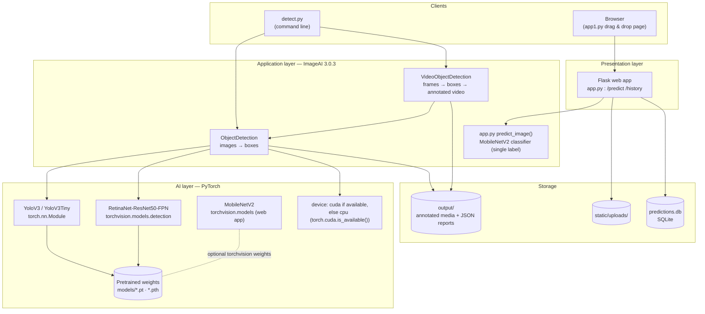
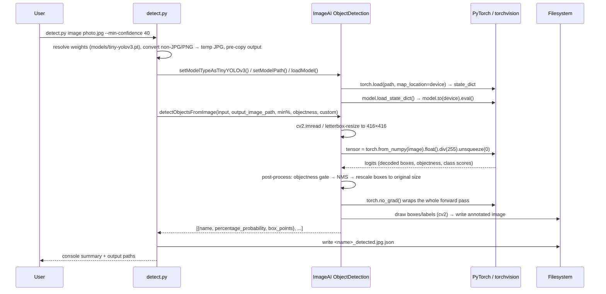
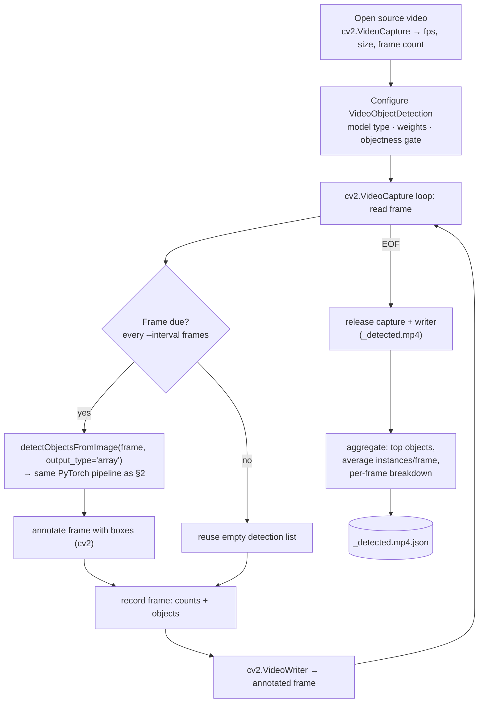

# Architecture

How `find_obj` is put together: components, the ImageAI/PyTorch inference core, and the
data flow for image and video detection.

Companion docs: [README](README.md) (usage) ·
[docs/pytorch-backend.md](docs/pytorch-backend.md) (why PyTorch is required).

---

## 1. System overview



### Components

| Component | Responsibility | Key files |
| --- | --- | --- |
| **CLI (`detect.py`)** | argument handling, model download/selection, file conversion, JSON reports | `detect.py` |
| **Web app** | upload validation, persistence, history API; optional MobileNetV2 *classification* | `app.py`, `app1.py` |
| **ImageAI** | owns the detection classes, preprocessing, post-processing (NMS), drawing, video frame loop | `imageai/Detection/__init__.py` (site-packages) |
| **PyTorch / torchvision** | tensor engine, model architectures, weight loading, device placement, forward pass | `torch`, `torchvision` |
| **OpenCV (cv2)** | image/video I/O: `imread`/`imwrite`, `VideoCapture`/`VideoWriter`, colour conversion, box drawing | `cv2` |
| **Storage** | annotated outputs + JSON reports (`output/`), uploads & history (`static/`, `predictions.db`) | — |

**Division of labour:** OpenCV does *media I/O and pixel plumbing*, PyTorch does
*all numeric/model work*, ImageAI *orchestrates* both behind a simple API.

---

## 2. Image detection pipeline



Key points:

* **One-time model load** — weights are read from disk into memory once
  (`loadModel()`), then every call reuses the loaded network.
* **Batch of 1** — images are `1×3×416×416` float tensors (YOLO) or resized RGB
  tensors (RetinaNet).
* **Two thresholds** — the raw *objectness* gate (ImageAI hard-codes `0.5`, exposed as
  `--objectness`) runs first; `--min-confidence` then filters what is reported/annotated.
* **Graceful output** — `detect.py` pre-copies the input to the output path, so a
  zero-detection result still leaves a valid (unannotated) image next to the JSON report.

---

## 3. Video detection pipeline



Notes:

* ImageAI **re-encodes** the video: every processed frame is written through
  `cv2.VideoWriter` (codec `mp4v`), so **audio is not carried over**.
* `--interval N` skips the forward pass on N-1 out of every N frames (the frame is still
  written; its last known detection list is empty), which is the main speed lever.
* `--max-seconds` stops the loop early; `--fps` overrides the output frame rate
  (defaults to the source FPS so playback speed is preserved).
* Callbacks `per_frame_function` and `video_complete_function` are how `detect.py`
  collects the per-frame records and the aggregate statistics for the JSON report.

---

## 4. What happens inside the PyTorch layer

| Stage | PyTorch/torchvision API | Where |
| --- | --- | --- |
| Device selection | `torch.cuda.is_available()` → `"cuda"`/`"cpu"` | `ObjectDetection.__init__` |
| Architecture build | `YoloV3Tiny(nn.Module)` or `torchvision.models.detection.retinanet_resnet50_fpn(...)` | `loadModel()` |
| Weight loading | `torch.load(path, map_location=device)` → `model.load_state_dict(...)` | `loadModel()` |
| Inference mode | `model.to(device).eval()`, forward under `torch.no_grad()` | `detectObjectsFromImage()` |
| Input tensor | `torch.from_numpy(...).float().div(255.0)` / `torch.FloatTensor` | `prepare_image()` |
| Post-processing | `torch.sigmoid`, `torch.max`, `torch.sort`, `torch.unique`, `torch.nonzero`, `torch.clamp`, IoU math — incl. **non-maximum suppression** | `get_predictions()` |
| Transfers & output | `.to(device)`, `.item()` for confidences/coordinates | throughout |

The web app's optional classifier (`app.py → load_model()`) adds a second, independent
use of the stack: `torchvision.models.mobilenet_v2(weights=...)` for single-label
classification.

---

## 5. Repository layout

```
find_obj/
├── detect.py                  # CLI entry point — see §1 "CLI"
├── app.py                     # Flask + SQLAlchemy web app (classification demo)
├── app1.py                    # standalone drag&drop demo (imports predict_image)
├── requirements.txt
├── README.md · ARCHITECTURE.md
├── docs/
│   └── pytorch-backend.md     # PyTorch requirement deep-dive
├── models/                    # weights registry (download target)
│   ├── tiny-yolov3.pt
│   ├── sample_coco.jpg        # sample image
│   └── cats.mp4               # sample video
├── output/                    # run results
│   ├── *_detected.jpg(.json)
│   └── *_detected.mp4(.json)
├── templates/index.html       # web UI
├── static/                    # css, js, uploaded images
├── predictions.db             # SQLite history for app.py
└── .venv/                     # Python 3.14 env with torch + imageai + opencv
```

**Output contract:** every run writes exactly one annotated media file and one
side-car `*.json` report of the same name; nothing else is modified.

---

## 6. Design decisions

| Decision | Rationale |
| --- | --- |
| CLI kept separate from Flask | detection of videos is long-running; the web app stays request/response. Both share the same ImageAI/PyTorch core, so a web endpoint for detection can be added later without touching inference code. |
| `tiny-yolov3` as default model | 34 MB, fastest backbone — sensible default for CPU-only machines; `--model` switches to `yolov3`/`retinanet` for accuracy. |
| Lazy, one-shot model load | loading weights takes seconds; done once per process (same idea as `app.py`'s `_get_model()` singleton). |
| Model files under `models/` with a `download` subcommand | weights are 34–248 MB and cannot live in the repo; a single command makes setup reproducible. |
| Pre-copy of image output | ImageAI silently skips writing when it finds nothing; pre-copying guarantees a valid file for downstream consumers. |
| `--objectness` exposed | works around ImageAI's hard-coded 0.5 gate, the most common cause of "video yields no detections". |
| Non-JPG/PNG converted through Pillow | ImageAI's loaders only accept `.jpg/.jpeg/.png`; conversion at the edge keeps the core pipeline untouched. |
| Reports as side-car JSON | human-readable, machine-readable, and trivially loadable into pandas/notebooks for video analytics. |

---

## 7. Extension points

* **Web endpoint for detection** — wrap `cmd_image()` logic in a Flask route
  (`POST /detect`) and stream `output/` files to the browser; the existing
  `static/uploads` + `/history` pattern already shows the plumbing.
* **GPU** — install CUDA PyTorch (README §Setup); ImageAI auto-selects `cuda`,
  or keep `--cpu` for reproducibility.
* **Batch folder processing** — loop `detect.py image` over a glob; the JSON side-cars
  make aggregation trivial.
* **Custom classes** — train a custom YOLOv3 in ImageAI (Pascal VOC → YOLO converter
  ships with the library) and point `--model-path` at the resulting `.pt` file.
* **Analytics** — `per_frame` records enable timelines, heatmaps, object counts per
  minute without re-running inference.
